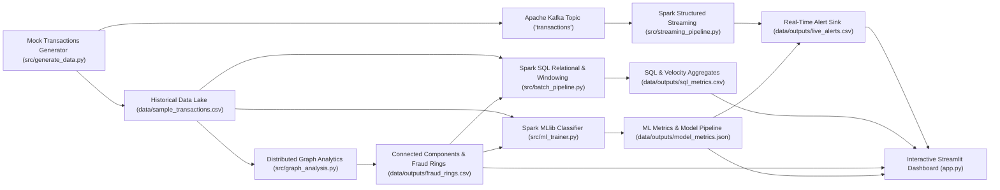

# Real-Time Financial Fraud Detection & Fraud Ring Analysis Platform
**Big Data Systems Architecture & Full-Stack Data Engineering**

[](https://spark.apache.org/)
[](https://kafka.apache.org/)
[](https://spark.apache.org/mllib/)
[](https://streamlit.io/)
[](https://www.python.org/)

---

## 📌 Syllabus & Technical Architecture Mapping

This platform strictly fulfills the syllabus components across Big Data Engineering, Graph Analytics, Relational SQL Windowing, Machine Learning, and Real-Time Stream Ingestion:

| Syllabus Unit | Technical Domain | Component in Platform | Implementation File |
| :--- | :--- | :--- | :--- |
| **Units I & V** | Batch vs. Real-Time Processing & Ingestion | Kafka Producer/Consumer & Spark Structured Streaming | [`src/producer.py`](file:///c:/Users/amegd/OneDrive/Desktop/Project/Fraud%20Detection/src/producer.py), [`src/streaming_pipeline.py`](file:///c:/Users/amegd/OneDrive/Desktop/Project/Fraud%20Detection/src/streaming_pipeline.py) |
| **Unit III** | Distributed Low-Level Collections & Graph Analytics | Spark RDDs (`map`, `reduceByKey`, `groupByKey`) & GraphX / GraphFrames Connected Components (Fraud Rings) | [`src/graph_analysis.py`](file:///c:/Users/amegd/OneDrive/Desktop/Project/Fraud%20Detection/src/graph_analysis.py) |
| **Unit IV** | Relational Analytics & Windowing | Spark SQL temporary views, joins, `GROUP BY`, `HAVING`, and window velocity aggregates | [`src/batch_pipeline.py`](file:///c:/Users/amegd/OneDrive/Desktop/Project/Fraud%20Detection/src/batch_pipeline.py) |
| **Unit VI** | Scalable Machine Learning & Performance Evaluation | Spark MLlib Logistic Regression & Decision Tree, Confusion Matrix, R², RMSE, ROC-AUC | [`src/ml_trainer.py`](file:///c:/Users/amegd/OneDrive/Desktop/Project/Fraud%20Detection/src/ml_trainer.py) |
| **Interactive UI** | Distributed Visualization & Monitoring | Multi-Tab Streamlit Dashboard (Live Alerts, SQL Metrics, Network Graph, ML Evaluation) | [`app.py`](file:///c:/Users/amegd/OneDrive/Desktop/Project/Fraud%20Detection/app.py) |

---

## 🏗️ System Architecture Flow



---

## 📂 Project Directory Structure

```
/fraud-detection-platform
├── docker-compose.yml          # Zookeeper, Kafka broker, and Kafka UI setup
├── requirements.txt            # Python & PySpark dependencies
├── data/
│   ├── sample_transactions.csv # Base historical transaction dataset (8,000 tx)
│   └── outputs/                # Storage sinks for pipelines and UI
│       ├── live_alerts.csv     # Real-time streaming flagged fraud alerts
│       ├── sql_metrics.csv     # Spark SQL windowed velocity & account metrics
│       ├── location_metrics.csv# Geographic risk distribution aggregates
│       ├── fraud_rings.csv     # Graph connected components & ring memberships
│       └── model_metrics.json  # MLlib evaluation metrics (Confusion Matrix, R², RMSE)
├── src/
│   ├── __init__.py
│   ├── generate_data.py        # Generates synthetic data with fraud topologies
│   ├── producer.py             # Kafka transaction stream publisher
│   ├── graph_analysis.py       # Spark RDD graph analytics & connected components
│   ├── batch_pipeline.py       # Spark SQL queries, windowing, and velocity checks
│   ├── ml_trainer.py           # Spark MLlib classification & performance evaluation
│   └── streaming_pipeline.py   # Spark Structured Streaming live scoring engine
├── app.py                      # Interactive 4-Tab Streamlit Web Dashboard
└── README.md                   # Complete architectural and execution guide
```

---

## 🚀 Quickstart & Execution Guide

### Step 1: Install Dependencies
```bash
pip install -r requirements.txt
```

### Step 2 (Optional): Start Kafka Infrastructure via Docker
To run Kafka and Zookeeper in Docker:
```bash
docker-compose up -d
```
> **Kafka UI** is available at: [http://localhost:8085](http://localhost:8085)  
> *Note: If Docker is not installed or not running, the platform automatically utilizes its built-in offline simulation mode without failing.*

### Step 3: Generate Base Dataset
Generate 8,000 synthetic transactions embedded with cyclic fraud rings, burst velocity attacks, and laundering funnels:
```bash
python src/generate_data.py
```

### Step 4: Run Distributed Analytics Pipelines
Run the batch analytics modules in sequence:

1. **Graph Analytics & Connected Components (Unit III):**
   ```bash
   python src/graph_analysis.py
   ```
   *Identifies multi-hop fraud rings and outputs cluster mappings to `data/outputs/fraud_rings.csv`.*

2. **Spark SQL Windowing & Velocity Analysis (Unit IV):**
   ```bash
   python src/batch_pipeline.py
   ```
   *Computes rolling 10-minute transaction velocity spikes and saves summary to `data/outputs/sql_metrics.csv`.*

3. **Spark MLlib Classifier Training & Evaluation (Unit VI):**
   ```bash
   python src/ml_trainer.py
   ```
   *Trains Logistic Regression & Decision Tree models, evaluates Confusion Matrix, ROC-AUC, Precision/Recall, R², and RMSE, and outputs to `data/outputs/model_metrics.json`.*

### Step 5: Start Real-Time Stream Processing
1. In Terminal 1, start the Kafka / Simulation Stream Producer:
   ```bash
   python src/producer.py --rate 2 --count 100
   ```
2. In Terminal 2, start the Real-Time Streaming Scorer:
   ```bash
   python src/streaming_pipeline.py
   ```

### Step 6: Launch the Streamlit Web Dashboard
Run the interactive web application:
```bash
streamlit run app.py
```
Open your browser at: **[http://localhost:8501](http://localhost:8501)**

---

## 🖥️ Dashboard Overview (4 Interactive Tabs)

### 🚨 Tab 1: Live Monitoring & Real-Time Alerts (Units I & V)
- **Live KPI Cards:** Total Flagged Alerts, Prevented Financial Loss ($), Average Threat Index, and Critical Ratio.
- **Auto-Refreshing Feed:** Reads real-time micro-batch scored transactions from `data/outputs/live_alerts.csv`.
- **Threat Index Gauge:** Dynamic gauge showing current platform fraud threat level.
- **Alerts Table:** Color-coded severity badges (Critical vs. High) with interactive threshold filtering.

### 📊 Tab 2: Spark SQL Relational Analytics (Unit IV)
- **Velocity Spikes:** Bar chart of accounts exhibiting burst drain behavior within 10-minute rolling windows.
- **Volume vs. Velocity Scatter Plot:** Interactive bubble chart identifying high-volume, high-velocity outlier accounts.
- **Geographic Risk Distribution:** Breakdown of transaction volume and fraud frequency by jurisdiction.
- **Aggregated Account Metrics:** Direct tabular rendering of Spark SQL `GROUP BY ... HAVING` queries.

### 🕸️ Tab 3: Fraud Ring Network View (Unit III)
- **Network Graph Topology:** Force-directed spring layout rendering vertices (accounts) and edges (transfers) with Plotly.
- **Cluster Highlighting:** Color-coded node risk scores highlighting cyclic mule networks and fan-in laundering hubs.
- **Component Inspector:** Detailed breakdown of connected components, ring sizes, and in/out degrees.

### 🤖 Tab 4: ML Model Performance & Evaluation (Unit VI)
- **Confusion Matrix Heatmaps:** Interactive True Positive (TP), False Positive (FP), True Negative (TN), and False Negative (FN) displays.
- **Comparative Metrics Table:** Side-by-side comparison between **Logistic Regression** and **Decision Tree Classifier**:
  - Accuracy, Precision, Recall, F1-Score
  - Area Under ROC (ROC-AUC) & Area Under PR
  - Root Mean Squared Error (RMSE) and Coefficient of Determination (R²)
- **ROC Trajectory:** Visual ROC curve comparing model discrimination capacity against chance.
- **Feature Importance:** Ranking of transaction amount, location, channel, and graph features (ring size, degree, graph risk).

---

## 🧪 Verification & Unit Testing

Run end-to-end verification across all modules:
```bash
# Verify graph analysis output
python -c "import pandas as pd; df=pd.read_csv('data/outputs/fraud_rings.csv'); print('Accounts analyzed:', len(df)); print('Rings detected:', df['is_ring_member'].sum())"

# Verify SQL metrics output
python -c "import pandas as pd; df=pd.read_csv('data/outputs/sql_metrics.csv'); print('High-risk SQL accounts:', len(df))"

# Verify ML metrics output
python -c "import json; m=json.load(open('data/outputs/model_metrics.json')); print('ML Model accuracy:', m['models']['logistic_regression']['accuracy'])"
```
